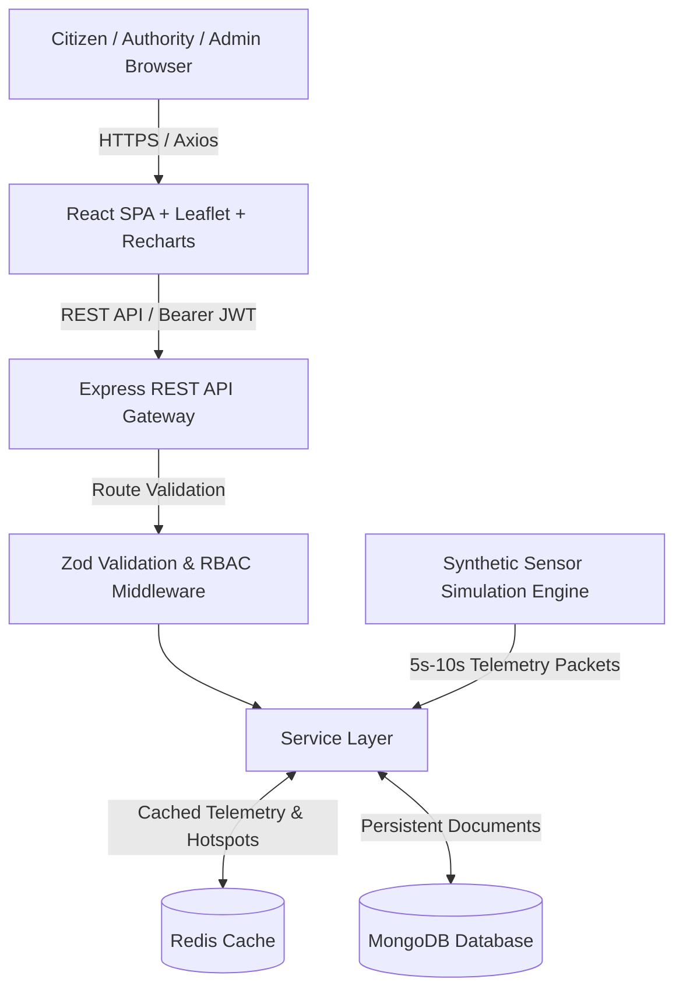

# Urban Noise Monitoring & Complaint Management System

[](https://en.wikipedia.org/wiki/MEAN_(solution_stack))
[](https://www.typescriptlang.org/)
[](https://www.mongodb.com/)
[](https://redis.io/)
[](https://www.docker.com/)

A full-stack municipal environmental intelligence platform engineered to monitor urban acoustic levels, identify noise pollution hotspots, manage citizen noise grievances with timeline audits, and enforce regulatory decibel limits across residential, commercial, industrial, and silent zones.

---

## 1. Project Overview

Modern cities face unprecedented acoustic pollution from construction, transit congestion, industrial machinery, and commercial nightlife. The **Urban Noise Monitoring & Complaint Management System** provides city administrators, environmental protection officers, and residents with:
- **Simulated Real-Time IoT Telemetry**: Continuous sound pressure level ($dB(A)$) telemetry streaming from sensor nodes deployed across city districts.
- **Hotspot Intelligence**: Automated spatial risk indexing pinpointing chronic violators based on average decibels, cap breaches, and public complaints.
- **Citizen Grievance Redressal**: End-to-end complaint filing with status transitions (`Submitted` $\rightarrow$ `Under Review` $\rightarrow$ `Assigned` $\rightarrow$ `In Progress` $\rightarrow$ `Resolved` / `Rejected`) and transparent audit timeline history.
- **Configurable Legal Thresholds**: Dynamic day/night permissible decibel limits tailored to specific zoning laws.
- **Interactive OpenStreetMap Geospatial Visualizer**: Live mapping of acoustic nodes, risk buffer zones, and complaint clusters.

---

## 2. Technology Stack (MERN Architecture)

| Layer | Technology | Description |
| :--- | :--- | :--- |
| **Frontend** | **React.js 18 + Vite** | Single-page application with modern responsive dashboard |
| **Language** | **TypeScript** | Strict end-to-end typing across frontend & backend |
| **Styling** | **Tailwind CSS** | Professional municipal dark theme with decibel severity tokens |
| **Charts & GIS** | **Recharts & Leaflet** | Area charts, bar distributions, pie breakdowns, and OSM map tiles |
| **Backend** | **Node.js & Express.js** | RESTful modular API with controller/service pattern |
| **Database** | **MongoDB + Mongoose** | Document store for stations, complaints, histories, and readings |
| **In-Memory Cache** | **Redis (ioredis)** | High-throughput cache for latest readings, hotspots, and overview stats |
| **Security** | **JWT & bcryptjs** | Role-based access control, password hashing, and rate limiting |
| **Containerization** | **Docker & Compose** | Unified multi-container orchestration |

---

## 3. Architecture & Data Flow



---

## 4. User Roles & Default Credentials

The platform enforces Role-Based Access Control (**RBAC**):

| Role | Access Permissions | Demo Email | Password |
| :--- | :--- | :--- | :--- |
| **Admin** | Full system control: modify legal decibel limits, provision monitoring stations, manage user roles, oversee complaints, view analytics. | `admin@city.gov` | `Password123!` |
| **Authority** | Inspect live telemetry, analyze hotspots, investigate complaints, assign officers, and commit resolution notes to the audit timeline. | `authority@city.gov` | `Password123!` |
| **Citizen** | Lodge noise complaints, view personal grievance history, inspect nearby station readings, and track resolution timelines. | `citizen@example.com` | `Password123!` |

---

## 5. Folder Structure

```
01-10project/
├── docker-compose.yml           # Unified orchestration (Mongo, Redis, API, Frontend)
├── package.json                 # Monorepo root workspace scripts
├── .gitignore                   # Ignores node_modules, dist, .env, docker volumes
├── .env.example                 # Global environment configuration template
├── backend/
│   ├── src/
│   │   ├── config/              # MongoDB connection, Redis client, env loader
│   │   ├── controllers/         # Auth, Station, Noise, Complaint, Hotspot, Analytics
│   │   ├── middleware/          # JWT auth, RBAC, Zod validation, error handler
│   │   ├── models/              # User, Station, NoiseReading, Complaint, History, Regulation
│   │   ├── routes/              # Express API routers
│   │   ├── services/            # Business logic and Redis caching layer
│   │   ├── jobs/                # Sensor telemetry simulator & seed database script
│   │   ├── validators/          # Zod schema definitions
│   │   ├── types/               # Domain TypeScript interfaces
│   │   ├── __tests__/           # Jest & Supertest integration suite
│   │   ├── app.ts               # Express application configuration
│   │   └── server.ts            # Server entrypoint with graceful shutdown
│   ├── Dockerfile               # Multi-stage production container build
│   ├── package.json
│   └── tsconfig.json
└── frontend/
    ├── src/
    │   ├── components/          # Navbar, Sidebar, StatusBadges, Modal
    │   ├── context/             # AuthContext (JWT state), ToastContext (alerts)
    │   ├── layouts/             # DashboardLayout wrapper
    │   ├── pages/               # Landing, Login, Register, Dashboard, Stations, Map,
    │   │                        # Complaints, Hotspots, Regulations, Analytics, Users
    │   ├── routes/              # AppRoutes with ProtectedRoute guards
    │   ├── services/            # Axios API client with auth interceptors
    │   ├── types/               # Frontend TypeScript domain types
    │   ├── utils/               # Decibel severity helpers & color mappings
    │   ├── App.tsx
    │   └── main.tsx
    ├── Dockerfile               # Multi-stage Nginx container build
    ├── nginx.conf               # SPA routing support
    ├── package.json
    ├── tailwind.config.js
    └── vite.config.ts
```

---

## 6. Installation & Local Setup

### Prerequisites
- **Node.js** v18+ or v20+
- **MongoDB** running locally on `localhost:27017` (or via Docker)
- **Redis** running on `localhost:6379` (optional: built-in graceful fallback is active if offline)

### Step 1: Clone and Install Dependencies
```bash
# Clone the repository
git clone <repo-url>
cd 01-10project

# Install root, backend, and frontend dependencies
npm install
```

### Step 2: Configure Environment Variables
Copy template `.env.example` files:
```bash
cp backend/.env.example backend/.env
cp frontend/.env.example frontend/.env
```

Ensure `backend/.env` points to your MongoDB instance:
```env
PORT=5001
MONGODB_URI=mongodb://localhost:27017/urban_noise_db
REDIS_URL=redis://localhost:6379
JWT_SECRET=super_secret_jwt_key_noise_monitor_2026_secure
JWT_EXPIRES_IN=7d
CORS_ORIGIN=http://localhost:5174
SIMULATION_INTERVAL_MS=5000
SIMULATION_ENABLED=true
```

And `frontend/.env`:
```env
VITE_API_BASE_URL=http://localhost:5001/api
```

### Step 3: Seed Demo Data
Populate the database with realistic municipal stations, regulations, users, and grievances:
```bash
npm run seed
```

### Step 4: Run the Application
Start both the backend server and frontend development server simultaneously:
```bash
npm run dev
```

- **Frontend Application**: `http://localhost:5174`
- **Backend API & Health Check**: `http://localhost:5001/api/health`

---

## 7. Docker Deployment

To launch the full production stack using Docker Compose:

```bash
docker compose up --build
```

Services will be launched at:
- **Frontend (Nginx)**: `http://localhost:5173`
- **Backend REST API**: `http://localhost:5000/api`
- **MongoDB**: `localhost:27017`
- **Redis**: `localhost:6379`

To stop the containers:
```bash
docker compose down
```

---

## 8. REST API Reference

### Authentication
- `POST /api/auth/register` — Register a new citizen account
- `POST /api/auth/login` — Authenticate and receive JWT token
- `GET /api/auth/me` — Retrieve current authenticated user profile

### Monitoring Stations
- `GET /api/stations` — List all acoustic stations (filterable by area type)
- `GET /api/stations/:id` — Get station details
- `POST /api/stations` — Provision a new monitoring station (*Admin*)
- `PUT /api/stations/:id` — Update station metadata (*Admin*)
- `DELETE /api/stations/:id` — Decommission station (*Admin*)

### Telemetry & Noise Readings
- `GET /api/noise` — Query historical noise readings
- `GET /api/noise/latest` — Fetch latest decibel readings (cached in Redis)
- `GET /api/noise/station/:stationId` — Time-series telemetry for a specific station
- `POST /api/noise` — Ingest sensor packet (*Authority / Admin*)

### Complaints & Timeline Auditing
- `GET /api/complaints` — Retrieve complaints (role-filtered)
- `GET /api/complaints/:id` — Get complaint details and full timeline history
- `POST /api/complaints` — Lodge citizen noise complaint
- `PATCH /api/complaints/:id/status` — Transition status & commit audit note (*Authority / Admin*)

### Hotspot Analysis & Regulatory Standards
- `GET /api/hotspots` — Algorithmic spatial hotspot ranking (cached in Redis)
- `GET /api/regulations` — View permissible day/night decibel thresholds
- `POST /api/regulations` — Configure new regulatory limits (*Admin*)
- `PUT /api/regulations/:id` — Update legal thresholds (*Admin*)

### Analytics
- `GET /api/analytics/overview` — High-level KPI summary (cached in Redis)
- `GET /api/analytics/noise` — Time-series trends and zone averages (*Authority / Admin*)
- `GET /api/analytics/complaints` — Complaint resolution velocity & category breakdown (*Authority / Admin*)
- `GET /api/analytics/compliance` — Zone-by-zone regulatory compliance ledger (*Authority / Admin*)

---

## 9. Automated Testing

The backend includes a comprehensive Jest + Supertest integration suite:

```bash
npm run test
```

Tests validate registration, authentication, protected route guards, complaint submission, status transition auditing, telemetry ingestion, and Redis cache retrieval.

---

## 10. Future Enhancements
1. **WebSocket / SSE Stream**: Direct server-sent events for sub-second telemetry graph updates.
2. **Citizen Audio Uploads**: Automated decibel and frequency spectrum estimation from submitted smartphone audio recordings.
3. **AI Complaint Triage**: Automatic classification of noise source and automated dispatch based on historical resolution patterns.
